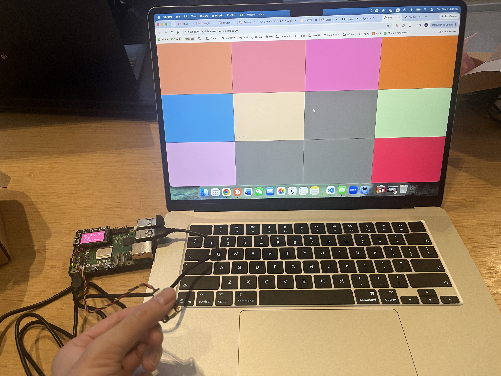
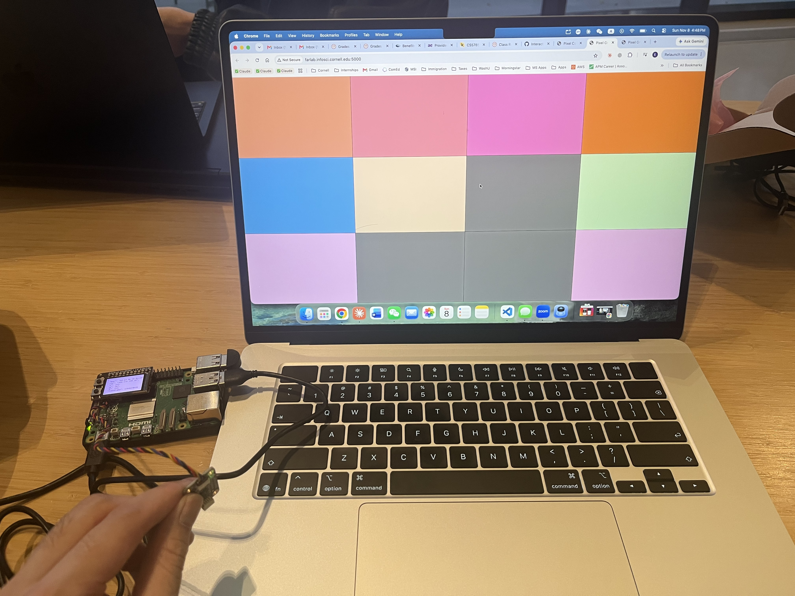
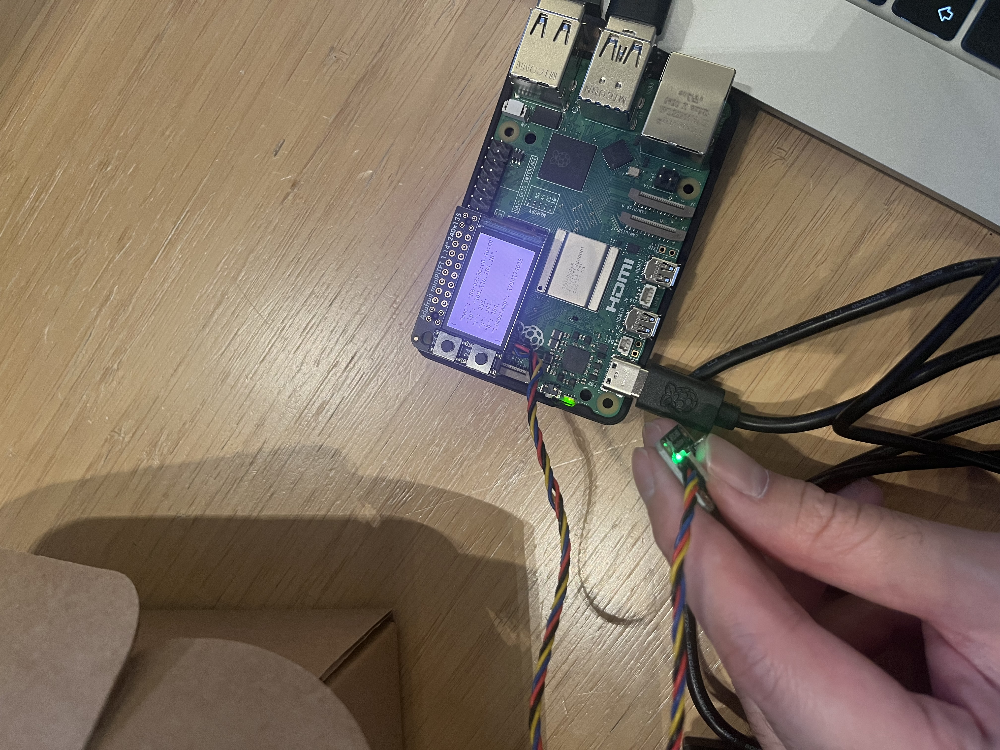
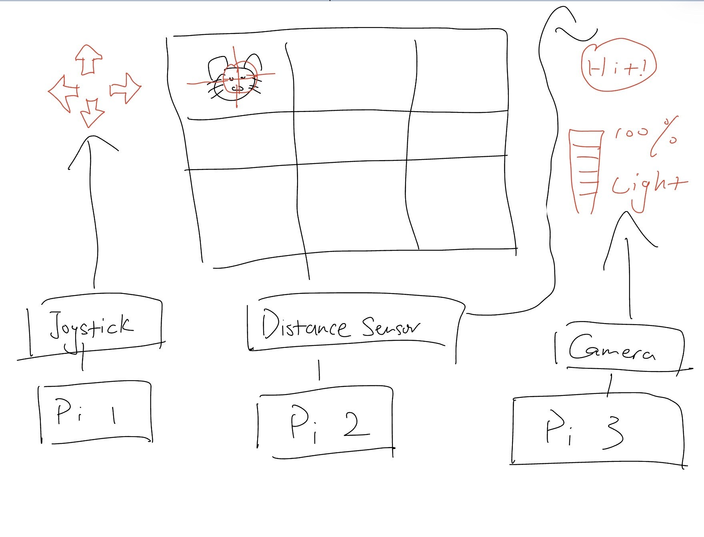
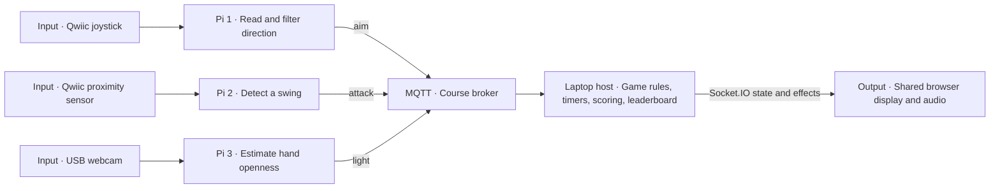
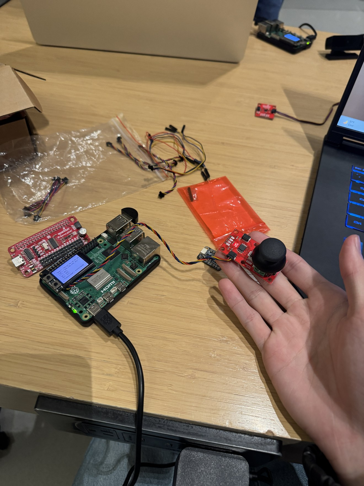
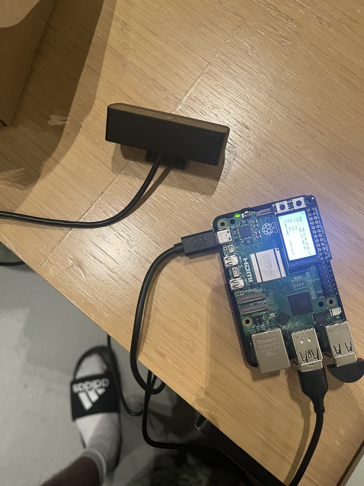
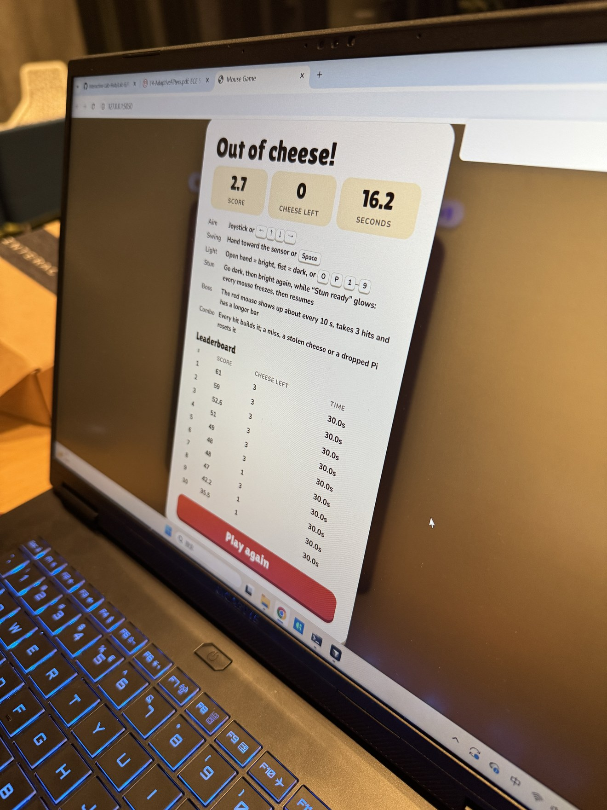

# Lab 6 — Distributed Interaction

**Yun Chung Liu, Pablo, Hong, Daniel Xing**

## Part A — MQTT Messaging Ideas

- **Three-player mouse game:** Pi 1's joystick moves the crosshair, Pi 2's proximity sensor swings the hammer when a hand comes close, and Pi 3's camera turns the game light on or off with an open palm or a fist. Each Pi publishes its move, and a laptop shows the shared game screen. Topics: `IDD/<team>/mouse-game/aim`, `IDD/<team>/mouse-game/attack`, `IDD/<team>/mouse-game/light`.
- **Roommate court across rooms:** building on our Lab 3 Mini Judge, one roommate files a complaint by voice on their Pi. The other roommate's Pi shows it and lets them answer with yes or no buttons, and the verdict appears on both screens. Topics: `IDD/<team>/court/complaint`, `IDD/<team>/court/reply`, `IDD/<team>/court/verdict`.
- **Friends' sky clock:** building on our Lab 2 sun and moon clock, each Pi publishes its local time of day, and every Pi shows a sun or moon for each friend, so you can see at a glance whether a friend far away is awake. Topic: `IDD/<team>/sky/<name>`, with messages like `day` or `night`.
- **Desk presence board:** inspired by the Presence Table reading, a camera or proximity sensor publishes whether someone is at their desk. The other Pis light up a dot for each friend who is there, a simple cue to say hi or study together. Topic: `IDD/<team>/presence/<name>`, with messages `here` or `away`.
- **Quiet please signal:** tap the capacitive sensor when you start studying, and the other Pis in the apartment show "Quiet please" until you tap it again. Topic: `IDD/<team>/quiet`, with messages `on` or `off`.

## Part B — Collaborative Pixel Grid

The APDS-9960 color sensor sends readings from the Raspberry Pi over MQTT. The shared browser grid updates the Pi's pixel as the sensed color changes.



Our pixel (bottom right) matches the pink on the Pi's screen.



With a different color under the sensor, our pixel and the Pi's screen both turn light purple.



Our setup: the APDS-9960 color sensor plugs into the STEMMA QT port under the Mini PiTFT, and the screen shows the color data the Pi sends.

## Part C — Mouse Game

### 1. Project Description

Mouse Game is a three-player arcade game about protecting a shared supply of cheese. One player moves a crosshair around a 3 × 3 board with a joystick. A second player swings the hammer by moving a hand toward a proximity sensor. A third player uses hand gestures to control the light. The team shares one score and has 30 seconds and three pieces of cheese by default. The round ends when time runs out or the last piece is stolen. The results screen records the score, cheese left, and time survived.

Mice appear in empty holes, pause before grabbing cheese, and then try to escape. The team can hit them during either stage. A red boss mouse appears roughly every 10 seconds, stays visible longer, and takes three hits. Successful attacks earn points. Hits, joystick moves from the Pi, and Pi brightness changes across 50% build the scoring combo. The score per hit rises at combo counts of 5, 10, and 20. A missed swing, stolen cheese, or controller disconnect resets the combo.

A closed fist darkens the board and an open palm brightens it. Partially open hands give intermediate brightness. In the dark, mice appear more often and are harder to see, so the team has more chances to score and more chances to fall behind. When the stun is ready, switching from below 50% brightness to at least 50% freezes the mice for 1.2 seconds. They resume their progress afterward. Players can keep aiming and swinging while the mice are frozen. The stun has a six-second cooldown.

### 2. Architecture Diagram



*Early interaction sketch showing how the three physical controls map to the board.*



The Pis process raw sensor data locally. The laptop is the single authority for the round, including the position used to judge each swing. The camera Pi sends a brightness value and processes its images locally.

### 3. Build Documentation

#### Hardware and prototype photos

| Station | Hardware and earlier lab work |
| --- | --- |
| Aim | Raspberry Pi with SparkFun Qwiic joystick over I²C. Reused the Lab 4 [joystick test](../Lab%204/joystick_test.py). |
| Attack | Raspberry Pi with a VCNL4040 proximity sensor over Qwiic/I²C. Reused the distance-sensing interaction from Lab 4's Patroller. See the Lab 4 [Qwiic distance example](../Lab%204/qwiic_distance.py) and the [Patroller threshold in the game configuration](mouse_game/config.py). |
| Light | Raspberry Pi with a USB webcam. Reused the Lab 4 [camera capture test](../Lab%204/camera_test.py) and Lab 5 [MediaPipe hand landmark work](../Lab%205/README.md#see-more-hands-and-pose-with-mediapipe). |



*The aiming station during bench testing.*



*The light-control station with its USB webcam and Raspberry Pi.*



*The result screen after an early round ending when the last cheese was stolen.*

#### MQTT messages

The default prefix is `IDD/mousegame/mouse-game`. The host and all three Pis use the same `MOUSE_TEAM` setting to select the namespace.

| Suffix | Example payload | Meaning |
| --- | --- | --- |
| `/aim` | `{"direction":"left"}` | Move the crosshair one hole. |
| `/attack` | `{"action":"swing"}` | Swing at the currently selected hole. |
| `/light` | `{"brightness":65}` | Set the in-game brightness to 65%. |
| `/status/<role>` | `{"online":false}` | Report controller availability. The MQTT last will can report an unexpected disconnect. |

#### Code and data flow

| Code | What it does |
| --- | --- |
| [`pi_aim.py`](mouse_game/pi_aim.py), [`pi_attack.py`](mouse_game/pi_attack.py), and [`controllers.py`](mouse_game/controllers.py) | Convert sensor readings into discrete actions. Returning the joystick to neutral rearms movement. Withdrawing the hand below the proximity release threshold rearms a swing. |
| [`pi_light.py`](mouse_game/pi_light.py) | Captures USB webcam frames with OpenCV and uses MediaPipe hand landmarks to estimate finger extension. Filters the estimate before publishing brightness in five-point steps. |
| [`pi_common.py`](mouse_game/pi_common.py) and [`config.py`](mouse_game/config.py) | Share MQTT publishing, connection status, topic names, and calibration and game settings across the devices. |
| [`host.py`](mouse_game/host.py) and [`game.py`](mouse_game/game.py) | Parse and queue MQTT and keyboard input, advance the round, resolve swings and stuns, and send snapshots and effects to the browser. |
| [`templates/game.html`](mouse_game/templates/game.html) | Render the board, show hit and miss feedback, and play the D minor pentatonic hit streak. |
| [`leaderboard.py`](mouse_game/leaderboard.py) | Persist one result per round in a host-side JSON file and rank results by score, cheese left, and survival time. |

The attack Pi publishes a single action after its detector confirms a swing. The host resolves that action against the crosshair and the current board.

```python
publisher.publish(config.TOPIC_ATTACK, {"action": "swing"})
```

The game engine records the selected hole and streak in the authoritative hit effect. The browser uses that streak value to select the hammer sound, rising pitch, and harmony. This sound follows consecutive hammer hits. Joystick and light actions can build the scoring combo without advancing the melody.

```javascript
sfx.hit(e.streak);
```

From `Lab 6/mouse_game`, run `python host.py` and open `http://localhost:5050`. Run `pi_aim.py`, `pi_attack.py`, and `pi_light.py` on their respective Pis. Use `--calibrate` to check readings without publishing. For keyboard-only testing, run `python host.py --no-mqtt` and use the arrow keys to aim, Space to swing, and O/P to set full brightness or darkness. See the [test notes](mouse_game/TESTING.md) for setup and troubleshooting.

### 4. User Testing

Here is the link to the video: [https://drive.google.com/file/d/1YJROz1CCVNgj_2_geI2zuaxNGTyaRKGE/view?usp=sharing](https://drive.google.com/file/d/1YJROz1CCVNgj_2_geI2zuaxNGTyaRKGE/view?usp=sharing)

The video shows two working Pis. The Pi assigned to the proximity sensor failed during the playtest, so the attack player used the Space bar to swing. The joystick and camera still ran on their Pis and sent actions over MQTT. We were able to test three-player coordination, but the recording does not show the physical attack sensor in use.

- **Tester 1 — joystick.** The crosshair felt slow to respond. Each push moved it only one cell, and the need to return to center before moving again made aiming feel cumbersome. A follow-up build could reduce input delay and test a controlled repeat when the stick is held.
- **Tester 2 — camera.** Gesture changes felt delayed, and the game sometimes interpreted an open palm and a fist the wrong way around. A follow-up build could check the hand-openness calibration and measure the time from changing the gesture to the board changing brightness.

### 5. Reflection

**What worked.** Sound and visual effects made the state changes easy to read. A hit gave the team immediate feedback, and dimming the board made the mice less visible as well as increasing their spawn rate. After several rounds of calibration, joystick direction, the proximity trigger, and the open-hand versus fist range were more reliable.

**What was hard.** The game moved quickly enough that the three players sometimes struggled to coordinate. Network delay could make an action arrive after its intended moment. For example, a delayed aim action could leave the crosshair on the wrong hole when a swing was processed and break the combo. The proximity sensor also provided less physical feedback than the joystick.

**What we would change.** We would slow the pace or give players a gentler start so they have time to coordinate. We would also try adding tactile feedback to the attack control so a player can feel when a swing registers.

**Where computation happened.** Each Pi processed its own sensor input, including hand landmarks on the camera Pi. The laptop resolved the game state and served the shared screen. One host gave all three players the same countdown, crosshair, and hit outcome even when inputs arrived at different times.
